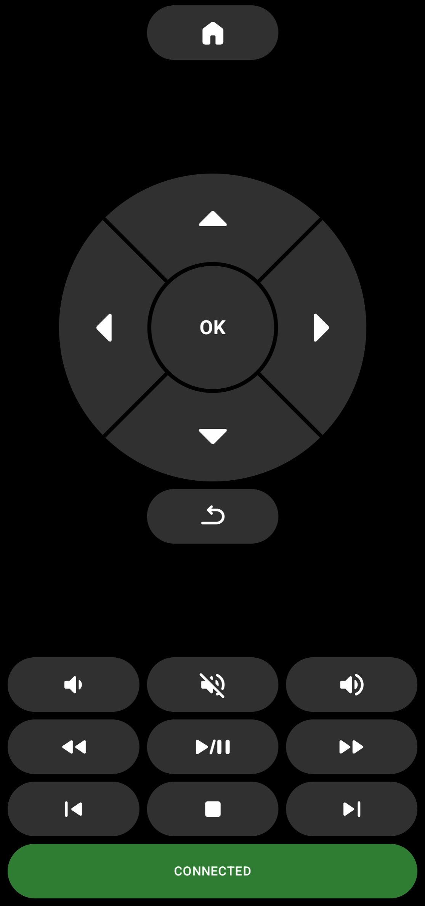

# atvremote

bare-minimum remote for my Freebox Player POP, replacing Remote ATV which stopped waking the box. D-pad, volume, media keys and the TV keyboard, nothing else.



it speaks the Android TV Remote v2 protocol, the same one as the google TV app, so other Android TV boxes should work too. I've only tested the Freebox.

## connection

- network first: TLS on port 6467 for pairing (6-character code shown on the TV), then 6466
- bluetooth fallback: RFCOMM to the box over the phone's existing bluetooth pairing, no code needed. it still works when the box's network is off in standby, so it can wake it

the app connects as soon as it's opened. the bottom button turns green when connected and opens setup.

## setup

1. pair the phone with the box in Android's bluetooth settings (or let the google TV app do it)
2. open the app, pick the box from the list
3. optionally enter the box IP and tap PAIR OVER NETWORK, then type the code from the TV
4. DONE

## power button

on the Freebox, POWER only turns the box off if Settings > System > Power button emission mode is set to BLE (bluetooth). in BLE + IR mode the box treats POWER from anything but its own remote as wake-only, so it turns on but never off.

with BLE the Freebox remote's power button stops sending IR to the TV, the box turns the TV off over HDMI-CEC instead.

## build

JDK 21 and Android SDK 36, then:

```
./gradlew installDebug
```

minimum Android 12.
